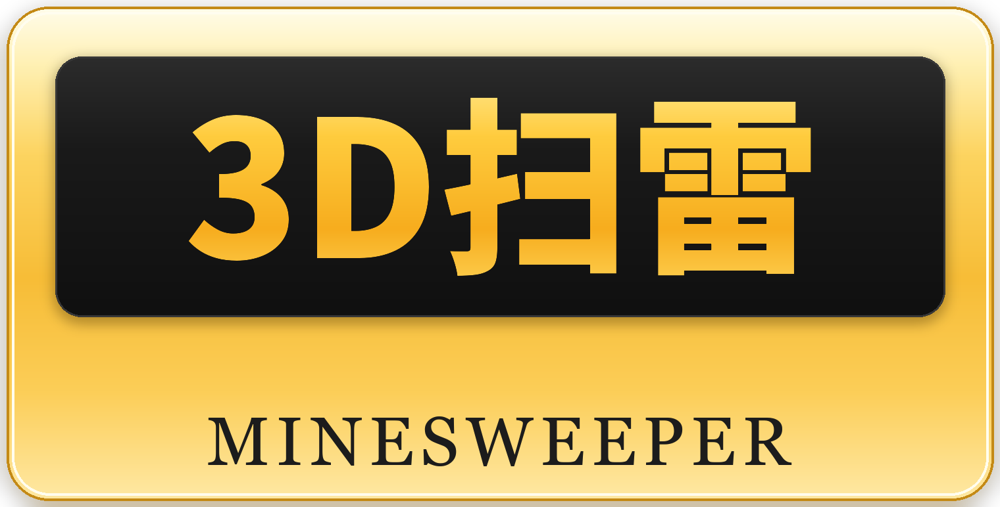

<div align="center">
  
</div>

<p align="center">
  <b>English</b> | <a href="README.zh-CN.md">简体中文</a>
</p>

<p align="center">
  <a href="https://github.com/Chilingyue/3D-Minesweeper/releases"></a>
  <a href="https://github.com/Chilingyue/3D-Minesweeper/releases/latest"></a>
  
</p>

Just for easy game.

A Windows desktop minesweeper that stacks the classic 2D board into **multiple layers** — you sweep plane by plane and have to think in three dimensions. With several difficulty levels and local best-score tracking.

## Download

| Option | Link |
| --- | --- |
| Latest build directly (`3D.exe`, ~26.4 MB) | [Releases](https://github.com/Chilingyue/3D-Minesweeper/releases/latest) |
| Web download page | https://chilingyue.github.io/3D-Minesweeper/web/index.html |

The **downloads** badge above is live: it counts every asset download across all releases and updates automatically.

## Features

- **3D visual experience** — layered boards instead of a single plane
- **Multiple difficulties** — from easy to nightmare, the board grows with the level
- **Best-score tracking** — results are saved locally, so you can chase your own record

## Requirements

- Windows
- No installer or runtime needed — download, unzip, double-click `3D.exe`
- To uninstall, just delete the file

## Project layout

```
3D-Minesweeper/
├─ README.md          # English (this file)
├─ README.zh-CN.md    # 简体中文
├─ tools/
│  └─ make_logo.py    # regenerates the brand logo
└─ web/               # download landing page (Tailwind CSS)
   ├─ index.html
   └─ imgs/
      ├─ logo.png     # brand logo
      └─ icon.png     # game icon
```
