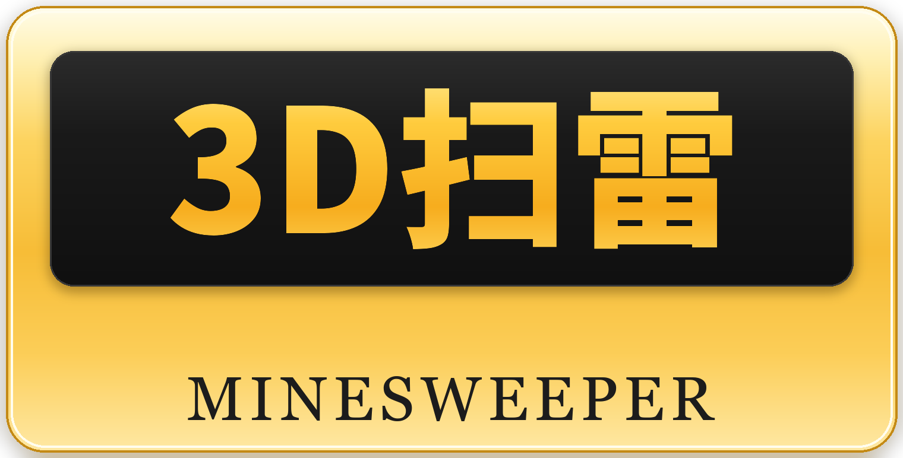

<div align="center">
  
</div>

<p align="center">
  <a href="README.md">English</a> | <b>简体中文</b>
</p>

<p align="center">
  <a href="https://github.com/Chilingyue/3D-Minesweeper/releases"></a>
  <a href="https://github.com/Chilingyue/3D-Minesweeper/releases/latest"></a>
  
</p>

Just for easy game.

一款 Windows 桌面扫雷小游戏，把传统二维雷区堆叠成**多层立体结构**——需要一层层翻着排查，用三维的空间感来判断周围雷的位置。内置多种难度与本地最佳成绩记录。

## 下载

| 方式 | 链接 |
| --- | --- |
| 最新版直接下载（`3D.exe`，约 26.4 MB） | [Releases](https://github.com/Chilingyue/3D-Minesweeper/releases/latest) |
| 网页下载页 | https://chilingyue.github.io/3D-Minesweeper/web/index.html |

上方「累计下载」徽章为实时数据：统计所有版本 Release 附件的下载次数，有人下载即自动更新。

## 玩法特点

- **3D 视觉体验**：多层立体雷区，不再只是一个平面
- **多种难度**：从入门到噩梦，随难度扩大雷区规模
- **游戏记录**：成绩保存在本地，随时挑战个人最佳

## 系统要求

- Windows
- 免安装、无需运行库：下载后直接双击 `3D.exe` 运行
- 卸载只需删除文件

## 项目结构

```
3D-Minesweeper/
├─ README.md          # English
├─ README.zh-CN.md    # 简体中文（本文件）
├─ tools/
│  └─ make_logo.py    # 生成品牌图标
└─ web/               # 在线下载落地页（Tailwind CSS）
   ├─ index.html
   └─ imgs/
      ├─ logo.png     # 品牌图标
      └─ icon.png     # 游戏图标
```
